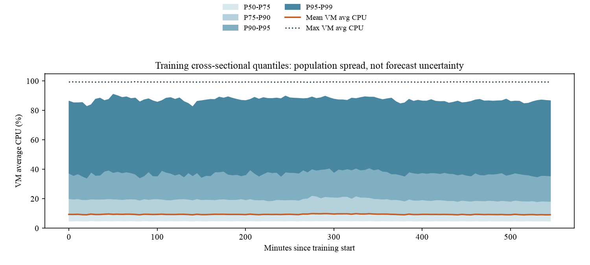
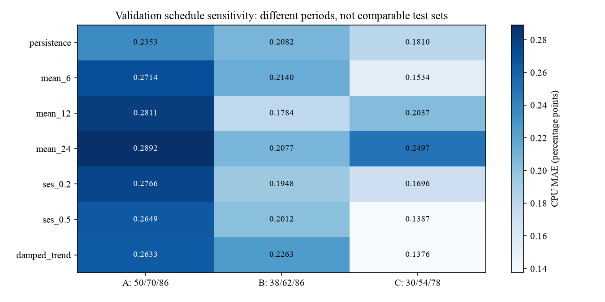
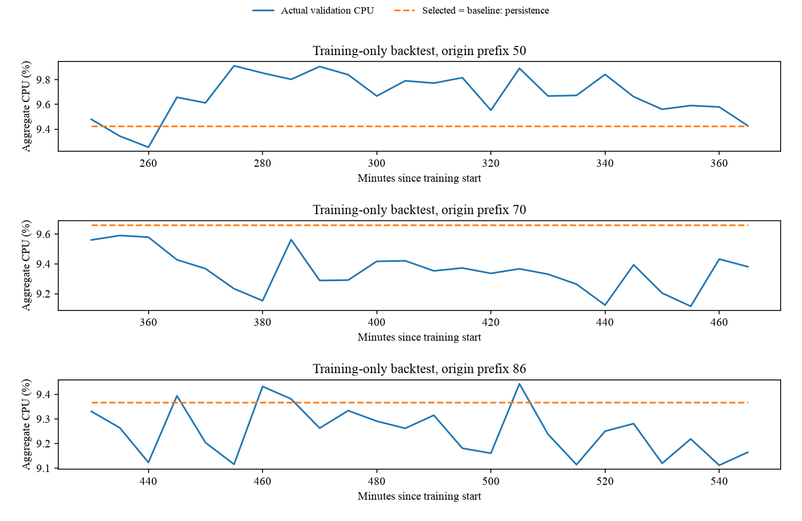

# Cloud Workload Forecasting Report

## 1. Executive Summary

This Azure `data-v1` sample is useful for short-horizon forecasts, but too short to establish how predictable cloud demand is in general. It contains **10,000 VMs** that report throughout the window, with mean training CPU of **9.4141%**. That average hides heavily utilized VMs and does not measure capacity-weighted utilization or absolute compute demand.

**Persistence remains selected for both targets.** Original training-only backtests give CPU MAE **0.235310 percentage points (pp)**, RMSE **0.274629 pp**, bias **+0.058641 pp**, and peak MAE **0.306193 pp**. MAE is **2.4995% of the training CPU mean**, not pointwise percentage error. All seven count candidates have zero error because population never changes, not because they predict churn.

Other training-only schedules favor a trailing mean or damped trend without changing selection. The final 24 target observations are never scored or plotted as forecast outcomes. Use persistence with an illustrative **0.50 pp buffer**, segment checks, and operator review, not automatic scaling or guaranteed coverage.

## 2. Data Understanding And Preprocessing

The [audit](results/audit.json) records **1,340,000 readings**, 10,000 matching metadata rows, and 134 timestamps from trace-relative second 0 to 39,900 at exact 300-second cadence. Each VM has 134 readings. It found no missing fields, duplicate keys, invalid CPU values, metadata mismatches, or cadence irregularities. This yields only **134 aggregate timestamps, 110 for development**, not 1.34 million independent forecasting examples.

Cleaning requires nonblank VM IDs and finite CPU percentages in `[0,100]`, with `min_cpu <= avg_cpu <= max_cpu`. Values in `[0,1]` are not rescaled. Invalid rows are excluded with warnings and audit counts. Valid duplicates are averaged within VM/timestamp to prevent duplicate weighting. Missing readings contribute neither VM nor CPU; missing or recordless timestamps and irregular cadence raise errors. No imputation or resampling occurs.

Before the chronological **110/24 split**, `active_vm_count` counts distinct represented VMs; `aggregate_cpu_utilization` averages their `avg_cpu` on the full grid. Neither estimates unobserved fleet members. CPU EDA uses only the first 110 timestamps; full-window coverage checks are structural.

All recorded creation times are zero; deletion-minus-creation spans have minimum 40,500 and median 2,591,400 seconds. These **recorded metadata spans** verify neither uncensored lifetimes nor simultaneous creation. Inclusive endpoints are an audit convention; source censoring/boundary semantics remain uncertain. No bounds violations occurred. Metadata CPU summaries have no above-100 values but unknown origin-time availability, so are excluded as predictors. Core/memory labels are categories, not exact capacities.

Complete traces in the first three source shards, category/core stratification, and stable SHA-256 ranking determine selection. This favors survivors, suppresses churn, and limits representativeness. Coverage, real creation/deletion, absolute compute demand, and equal-VM mean CPU remain distinct.

## 3. Workload Analysis

Training mean CPU spans **9.1116%-9.9122%** (temporal std. **0.1936 pp**), while cross-VM P95 spans **34.2264%-41.1702%** and P99 **82.5398%-91.0373%** per timestamp. The fan shows population dispersion, not forecast uncertainty. Low means can hide resource-starvation risk, but these traces establish neither starvation nor SLA violations. Lag-one autocorrelation **0.6672** and largest five-minute change **0.4368 pp** support persistence locally, not across unobserved daily/weekly cycles. Trace-relative time has no established calendar/timezone mapping.

**Representation is not activity.** Each timestamp represents **10,000 VMs**; the illustrative workload-active rule `avg_cpu > 5 AND max_cpu > 20` counts **2,561-2,951**. Training VM means classify **4,635 low (<5%)**, **5,145 moderate (5%-50%)**, and **220 high (>50%)**. Separately, **437** VMs ever have interval-average CPU >80%, **2,235** interval-maximum CPU >80%, and **1,000** meet the top-decile within-VM variability flag (std. q90 **6.1846 pp**). These descriptive flags overlap; they are not incident labels.

Pooled readings have median **5.1198%**, P95 **37.2932%**, and P99 **87.4063%**; **1.2721%/0.5663%** reach 80%/95%. The retrospectively hottest 100 VMs contribute **71.61% of 13,993 >=80% readings**, warranting [inspection of persistent hot subsets](results/workload_concentration.json).

Delay-insensitive, Interactive, and Unknown VMs average **8.2573%, 11.5051%, and 10.3547%**; their >=80% reading shares are **0.8923%, 1.9120%, and 1.7783%**. These differences warrant separate monitoring, but workload mix is only a plausible explanation, not a causal finding.

Category-mean temporal variability differs from cross-VM dispersion:

| Category | VMs | Temporal std. (pp) | Largest 5-min change (pp) |
|---|---:|---:|---:|
| Delay-insensitive | 6,180 | 0.2170 | 0.3936 |
| Interactive | 3,091 | 0.2433 | 0.7157 |
| Unknown | 729 | 0.6290 | 0.8489 |

Smaller groups smooth less variation; Unknown's volatility is not causal evidence. See [segment variability](results/segment_variability.csv); tiny buckets like `>64` memory (10 VMs) are unrepresentative. These are not segment forecasts.

## 4. Forecasting Approach

Seven deterministic univariate candidates are fixed before EDA: last-value persistence; trailing means over **6, 12, or 24** observations; simple exponential smoothing (SES) with alpha **0.2 or 0.5**; and damped Holt trend with fixed alpha **0.3**, beta **0.1**, and damping **0.9**. These test smoothing and restrained trend extrapolation against the latest level.

Persistence and means forecast constants; means use available trailing history. SES starts at the first value, updates recursively, then holds its final level. Damped trend starts at zero trend and projects a geometrically damped continuation without coefficient optimization. Counts use `np.rint` nearest-integer rounding (ties to even), bounded below by zero; CPU is clipped to `[0,100]`.

Models use only past targets, not deletion times, metadata CPU summaries, future aggregates, or calendar features. Seasonal-naive lacks an established period; trees and neural networks lack substantial independent history. Exclusion controls scope, not potential usefulness. The selected model refits on **110 training observations** for 24 forecasts without holdout updates.

## 5. Validation Methodology

Original expanding windows fit prefixes of **50, 70, and 86** observations and forecast **24 five-minute steps**, matching the final two-hour task. Zero-based windows **50-73, 70-93, and 86-109** yield **72 pooled errors** per candidate/target but only **60 distinct timestamps**. Overlapping decisions are not independent.

Selection minimizes pooled MAE per target; candidate-order ties favor persistence. Candidates share origins, horizons, and metrics. Selection freezes before training-only sensitivity checks on schedules **38/62/86** and **30/54/78**, which do not revise it.

Error is prediction minus actual. RMSE emphasizes large errors; bias gives direction. **Normalized MAE = MAE / training-target mean**, expressed as a percentage, uses a fixed training-only denominator, not near-zero individual outcomes. CPU's denominator is **9.414089019539009%**. Improvement is relative to the best persistence/mean baseline and undefined when its MAE is zero.

Peak cases have actual CPU at least the fitting prefix's **90th percentile**, recomputed from past data at each origin. Substituting extreme finite and missing holdout labels leaves predictions, backtests, and selection unchanged in the [holdout isolation check](results/holdout_isolation_check.json). This verifies forecasting-boundary label isolation, not accuracy.

## 6. Results Versus Baseline

Original-schedule [errors](results/model_comparison.csv) are in **pp**; rounding leaves rankings unchanged.

| Candidate | MAE | RMSE | Peak MAE |
|---|---:|---:|---:|
| **Persistence** | **0.235310** | **0.274629** | **0.306193** |
| Mean 6 | 0.271409 | 0.314064 | 0.364213 |
| Mean 12 | 0.281126 | 0.329910 | 0.373491 |
| Mean 24 | 0.289180 | 0.318631 | 0.371043 |
| SES 0.2 | 0.276596 | 0.320205 | 0.367535 |
| SES 0.5 | 0.264916 | 0.308751 | 0.352657 |
| Damped trend | 0.263274 | 0.311696 | 0.363078 |

Persistence wins original-schedule MAE, RMSE, and peak MAE, with normalized MAE **2.499548%**. Damped trend's MAE is **11.88% worse** despite lower bias. All count candidates have MAE/RMSE/bias/peak MAE **0**, normalized MAE **0%**, and undefined baseline-relative improvement.

| Origins | Diagnostic MAE favorite | Best MAE | Persistence MAE |
|---|---|---:|---:|
| 50/70/86 | Persistence | 0.235310 | 0.235310 |
| 38/62/86 | Mean 12 | 0.178385 | 0.208198 |
| 30/54/78 | Damped trend | 0.137625 | 0.181039 |

The [sensitivity results](results/validation_sensitivity.csv) show **ranking instability**, not superiority across differently scored periods. The [full schedule results](results/schedule_diagnostics.csv) retain MAE, RMSE, bias, and maximum absolute error for every candidate, by origin and pooled. Count errors remain zero; selection stays frozen.

## 7. Error And Failure Analysis

[Origin errors](results/origin_metrics.csv) are in **pp**. Missing peak MAE means no qualifying cases, not zero error.

| Origin | MAE | RMSE | Bias | Max abs. | Peaks | Peak MAE |
|---|---:|---:|---:|---:|---:|---:|
| 50 | 0.2681 | 0.3028 | -0.2467 | 0.4858 | 20 | 0.3062 |
| 70 | 0.3054 | 0.3329 | +0.3054 | 0.5468 | 0 | N/A |
| 86 | 0.1324 | 0.1542 | +0.1172 | 0.2551 | 0 | N/A |

Persistence misses a rise at origin 50 and overpredicts the lower level at origin 70. Pooled bias **+0.058641 pp** masks opposing risks; it offers no reliable peak protection. Maximum absolute error **0.5468 pp** is an overprediction; maximum underprediction is **0.48582143 pp**.

All **20 peak cases** occur at origin 50, with past-only threshold **9.5202%**. Origins 70 and 86 have thresholds **9.8038%** and **9.7815%**, with no qualifying outcomes. Pooled peak MAE describes one regime, not three independent peak tests.

Pooled first-six-step MAE is **0.1806 pp**, versus **0.2491 pp** for the last six. By origin, first/last-six MAEs are **0.2020/0.1840**, **0.2024/0.3873**, and **0.1373/0.1759 pp**. Error is not monotonic: origin 50 improves late; origin 70 deteriorates. Three decisions per horizon make estimates noisy; [origin/horizon errors](results/origin_horizon_errors.csv) support inspection, not confidence intervals. Refreshing forecasts with new readings needs separate validation.

Underprediction occurs in **22/24**, **0/24**, and **4/24** cases by origin. Retrospectively, fitting-prefix positive-change q90 defines large upward steps: **2** qualify versus **26** smaller steps. Their persistence MAEs, **0.1654/0.2263 pp**, do **not** establish greater vulnerability to abrupt rises. Smaller steps need not be gradual trends; noisy groups confound origin and horizon. All-candidate downside and change-group tables remain in the appendix.

## 8. Capacity-Planning Recommendation

Use persistence for monitoring, not capacity allocation. Underprediction magnitude is `max(actual - prediction, 0)`; selected-validation q95 is **0.42116067 pp**, maximum **0.48582143 pp**. Rounding the maximum up gives the unchanged illustrative **0.50 pp buffer**, not calibrated coverage: these overlapping errors also served selection.

Separately, the [horizon schedule](results/capacity_schedule.csv) adds an illustrative allowance to the frozen **9.164556%** forecast: P95-envelope allowance **0.047577 pp at 5 minutes** versus **0.437239 pp at 120 minutes**, yielding mean-CPU references **9.212133%/9.601795%**. These cumulative maxima of raw positive-part residual quantiles use only **three samples per horizon**. They are not coverage probabilities, new predictions, buffer retuning, or absolute capacity requirements. The appendix distinguishes raw P90/P95 from the conservative monotone display heuristic.

Compare `min(100, forecast + 0.50)` with a **team-configured threshold T** for review, not machine additions. Individual 80%/95% cutoffs are not aggregate alert thresholds. Larger buffers reduce missed rises but increase alerts and possible overprovisioning; set thresholds from independent service objectives, scaling latency, and incident costs.

**Hypothetical, not an Atomity threshold:** forecast 9.6% + 0.50 pp = 10.1% crosses T = 10.0%, prompting segment CPU, latency/error-rate, and coverage checks. Underprediction could leave resources short during scaling delay; overprediction could waste resources or review effort. Asymmetric loss weighting remains hypothetical and service-dependent: no observed SLA outcomes or cost ratio establish either as far costlier.

Monitor high-utilization segments alongside the mean. Coverage loss, delayed telemetry, buffer exceedances, or rising segment high-load shares warrant review, but are not validated incident detectors. Do not downsize on a low mean: without capacities and placement, equal-VM CPU cannot determine cores, VM additions, or absolute demand.

## 9. Limitations And Future Work

Suppressed churn prevents transferring count accuracy to arrivals/departures. The two-hour horizon is **21.8% of 110 training points**; local levels, ramps, and reversals matter. Overlap and selection weaken evidence; peaks cover one origin. Results establish no external generalization, causal segment effect, calibrated uncertainty, or holdout performance.

Collect at least **seven days (2,016 five-minute samples)** before testing future candidates: an equal-weight persistence/Mean-12 ensemble or adaptive window. Seven days is a collection milestone, not sufficient evidence or proven improvement. Before production changes, reserve non-overlapping evaluation, validate buffers independently, measure service losses, and use origin-available metadata and trustworthy capacities.

## 10. Reproducibility And Artifacts

The [README](../README.md) covers release checksums, installation, tests, prediction, and analysis commands. The executed [notebook](../notebooks/workload_analysis.ipynb) uses the tested package. Provenance resides in `results/selection.json`, `audit.json`, and `analysis_summary.json`; exclusions in the [decision log](decision_log.md). Root `predictions.csv` and `predictions.selection.json` preserve unscored final forecasts and selection. `scripts/render_report.py` renders this source; `scripts/verify_clean_copy.py` checks isolated reproduction.

### Appendix: Supporting Evidence

Main figures appear inline only. Supporting analysis is training-only; full-window data-quality coverage is structural, not a holdout forecast outcome.

One-sided loss is `max(actual - prediction, 0)`, including zeros for overpredictions. The [directional comparison](results/directional_errors.csv) summarizes all seven candidates identically, by original origin and pooled. Persistence's pooled underprediction frequency is **26/72 (36.11%)**, zero-inclusive mean shortfall **0.088335 pp**, q95 **0.421161 pp**, and maximum **0.485821 pp**. This describes observed downside, not independent calibration or grounds to retune selection.

| Origin | Underprediction cases | Mean shortfall (pp) | Q95 shortfall (pp) |
|---|---:|---:|---:|
| 50 | 22/24 | 0.257413 | 0.477701 |
| 70 | 0/24 | 0.000000 | 0.000000 |
| 86 | 4/24 | 0.007590 | 0.059398 |

[Change diagnostics](results/change_error_summary.csv) and [step records](results/change_errors.csv) retain all candidates, N/A empty groups, and past-only cutoffs. Actual step labels serve validation only, never forecasting, selection, or operational threshold calibration.

**Horizon headroom construction.** Residuals here are `actual - prediction`, opposite to stored signed `error = prediction - actual`. Each horizon has three positive-part samples, including overprediction zeros, from overlapping original validation windows. Raw P90/P95 use empirical order statistics with linear interpolation, not calibrated 90%/95% future coverage. Cumulative maxima impose monotonicity for conservative display; raw empirical risk need not increase. Adding each envelope to the frozen forecast and clipping to `[0,100]` gives a mean-CPU reference, not provisioned compute. The [24-row schedule](results/capacity_schedule.csv) retains raw quantiles, envelopes, and references; the fixed 0.50 pp review heuristic remains unchanged.

**Activity and population caveats.** Workload-active status combines interval average and maximum, not metadata membership. VM mean classes and within-VM standard deviations are training-only. High mean, peak average, peak interval maximum, and burstiness flags overlap; never sum them as distinct VMs. The fan shows cross-VM dispersion, not future fleet-mean uncertainty.

- [VM distribution and high-utilization shares](figures/vm_utilization.png): heterogeneous utilization warrants tail monitoring. [Distribution table](results/vm_mean_distribution.csv).
- [Training metadata segments](figures/segments.png): monitor differences; treat small groups cautiously. [Segment table](results/segment_summary.csv).
- [Autocorrelation](figures/autocorrelation.png): supports local persistence, not seasonality. [Lag table](results/autocorrelation.csv).
- [Horizon errors](figures/horizon_errors.png): three origins cannot establish smooth error growth. [Horizon metrics](results/horizon_errors.csv).
- [Residual and peak diagnostics](figures/residual_bias_peak_errors.png): bias masks directional failures and concentrated peaks. [Origin metrics](results/origin_metrics.csv).
- [Data quality](figures/data_quality.png): balanced coverage limits changing-fleet generalization.
- [Training CPU and coverage](figures/training_cpu_coverage.png): constant 10,000 represented VMs does not imply constant workload-active counts.
- [Original model comparison](figures/model_comparison.png): selection retained alongside schedule sensitivity checks.
- [Horizon headroom](figures/horizon_headroom.png): descriptive cumulative-max P90/P95 envelopes, not calibrated prediction intervals.

[Training targets](results/targets_train.csv), [time summaries](results/training_time_summary.csv), [backtest errors](results/backtest_errors.csv), [origin/horizon errors](results/origin_horizon_errors.csv), [sensitivity](results/validation_sensitivity.csv), [missingness](results/missingness.csv), and [coverage](results/coverage.csv) permit inspection without exported holdout CPU labels.
